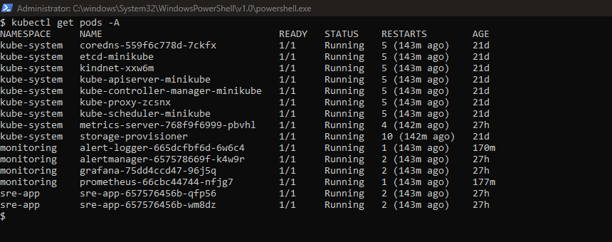
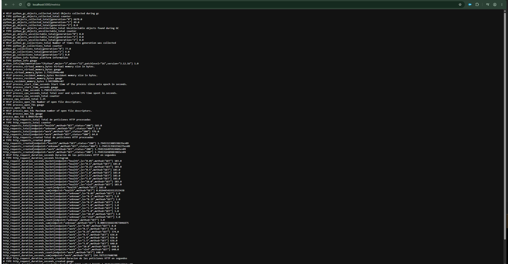
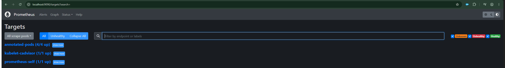
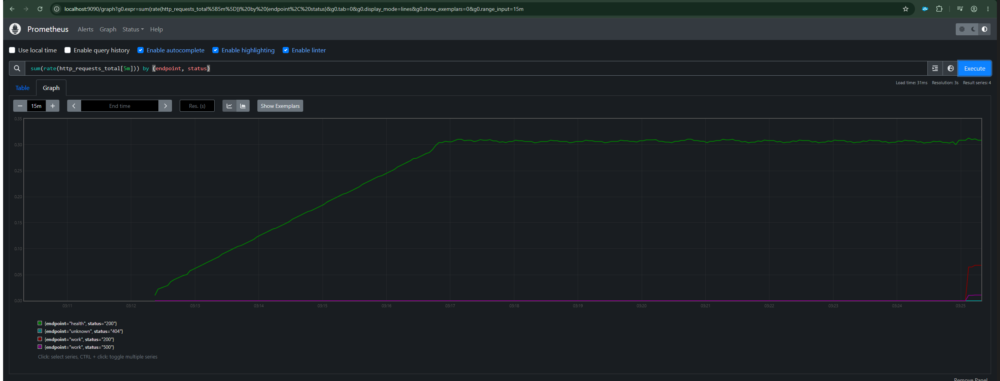
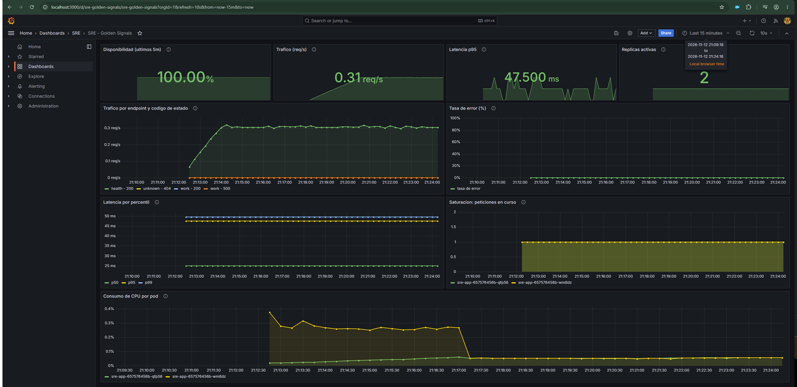
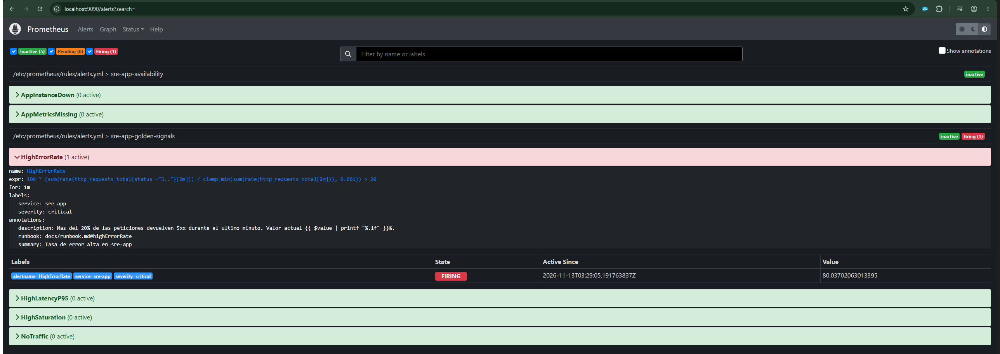
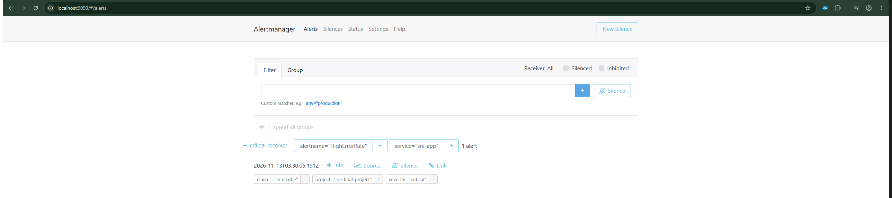
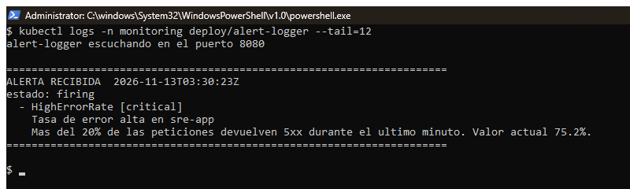
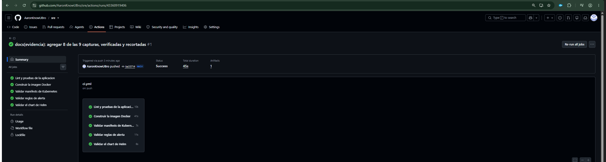

# Proyecto Final SRE — Stack de Observabilidad en Kubernetes

Implementacion completa de un stack de Site Reliability Engineering: una
aplicacion instrumentada desplegada en Kubernetes, monitoreada con Prometheus,
visualizada en Grafana y con alertas enrutadas por Alertmanager.


---

## Tabla de contenidos

- [Objetivo](#objetivo)
- [Arquitectura](#arquitectura)
- [Estructura del repositorio](#estructura-del-repositorio)
- [Requisitos previos](#requisitos-previos)
- [Despliegue rapido](#despliegue-rapido)
- [Despliegue paso a paso](#despliegue-paso-a-paso)
- [Accesos a las interfaces](#accesos-a-las-interfaces)
- [La aplicacion y sus metricas](#la-aplicacion-y-sus-metricas)
- [Alertas configuradas](#alertas-configuradas)
- [Como disparar cada alerta](#como-disparar-cada-alerta)
- [Notificaciones externas](#notificaciones-externas)
- [Despliegue con Helm](#despliegue-con-helm)
- [Pipeline de CI/CD](#pipeline-de-cicd)
- [Evidencia de la implementacion](#evidencia-de-la-implementacion)
- [Solucion de problemas](#solucion-de-problemas)
- [Limpieza](#limpieza)
- [Cumplimiento de los requisitos](#cumplimiento-de-los-requisitos)
- [Documentacion adicional](#documentacion-adicional)
- [Licencia](#licencia)

---

## Objetivo

El proyecto demuestra el ciclo completo de observabilidad que un equipo de SRE
opera en produccion:

**instrumentar** una aplicacion → **recolectar** sus metricas → **visualizar**
el comportamiento del sistema → **alertar** cuando se degrada → **documentar**
como responder.

La aplicacion incluida no es un simple "hola mundo": expone los cuatro
[Golden Signals](https://sre.google/sre-book/monitoring-distributed-systems/)
(latencia, trafico, errores y saturacion) y ofrece endpoints que permiten
provocar cada escenario de falla de forma controlada, para poder demostrar
que las alertas funcionan de verdad.

---

## Arquitectura

```
                        ┌──────────────────────────┐
                        │   Navegador del usuario  │
                        └────────────┬─────────────┘
                                     │ NodePort / port-forward
   ┌─────────────────────────────────┼─────────────────────────────────┐
   │ Cluster Kubernetes (Minikube)   │                                 │
   │                                 │                                 │
   │  ┌───────────── namespace: sre-app ──────────────┐                │
   │  │   ┌─────────────┐      ┌─────────────┐        │                │
   │  │   │  sre-app    │      │  sre-app    │        │                │
   │  │   │  pod 1      │      │  pod 2      │        │                │
   │  │   │  :5000      │      │  :5000      │        │                │
   │  │   │  /metrics   │      │  /metrics   │        │                │
   │  │   └──────┬──────┘      └──────┬──────┘        │                │
   │  └──────────┼────────────────────┼───────────────┘                │
   │             │   scrape cada 15s  │                                │
   │             │  (descubrimiento por anotaciones)                   │
   │  ┌──────────┴────── namespace: monitoring ───────┴─────────────┐  │
   │  │   ┌──────────────┐  evalua reglas  ┌──────────────────┐     │  │
   │  │   │  Prometheus  ├────────────────>│  Alertmanager    │     │  │
   │  │   │  :9090       │    alertas      │  :9093           │     │  │
   │  │   └──────┬───────┘                 └────────┬─────────┘     │  │
   │  │          │ consultas PromQL                │ webhook        │  │
   │  │          v                                 v                │  │
   │  │   ┌──────────────┐                 ┌──────────────────┐     │  │
   │  │   │  Grafana     │                 │  alert-logger    │     │  │
   │  │   │  :3000       │                 │  :8080           │     │  │
   │  │   └──────────────┘                 └──────────────────┘     │  │
   │  └─────────────────────────────────────────────────────────────┘  │
   └───────────────────────────────────────────────────────────────────┘
```

El detalle del flujo de datos y las decisiones de diseno estan en
[`docs/architecture.md`](docs/architecture.md).

---

## Estructura del repositorio

```
.
├── app/                          Aplicacion instrumentada
│   ├── app.py                    Flask + prometheus_client
│   ├── requirements.txt          Dependencias fijadas por version
│   └── Dockerfile                Imagen slim con usuario sin privilegios
│
├── k8s/                          Manifests de Kubernetes (orden de aplicacion)
│   ├── 00-namespaces.yaml        Namespaces sre-app y monitoring
│   ├── 10-app.yaml               Deployment y Service de la aplicacion
│   ├── 20-prometheus-rbac.yaml   ServiceAccount, ClusterRole y Binding
│   ├── 21-prometheus.yaml        Configuracion, reglas de alerta y despliegue
│   ├── 30-alertmanager.yaml      Alertmanager y receptor de webhooks
│   └── 40-grafana.yaml           Grafana con datasource y dashboard por codigo
│
├── helm/sre-app/                 Chart de Helm de la aplicacion (bonus IaC)
│   ├── Chart.yaml
│   ├── values.yaml
│   └── templates/
│
├── scripts/
│   ├── cluster.sh                Despliegue completo con un comando
│   ├── setup-wsl.sh              Instalador de herramientas para WSL2 en Windows
│   ├── verify.sh                 Verificacion de extremo a extremo del stack
│   ├── diagnose.sh               Reporte completo de diagnostico ante fallas
│   ├── _report.py                Formateo de las respuestas de las APIs
│   ├── load-test.sh              Generador de trafico y de escenarios de falla
│   ├── capture.ps1               Ayudante de screenshots para Windows
│   └── capture.sh                Envoltorio para invocarlo desde WSL
│
├── docs/
│   ├── architecture.md           Flujo de datos y decisiones de diseno
│   ├── runbook.md                Procedimiento de atencion de cada alerta
│   └── images/                   Screenshots de evidencia
│
├── .github/workflows/ci.yml      Pipeline de CI (bonus CI/CD)
├── CONTRIBUTING.md
├── LICENSE.md
└── README.md
```

---

## Requisitos previos

| Herramienta | Version minima | Verificar con |
| ----------- | -------------- | ------------- |
| Docker      | 24.x           | `docker --version` |
| Minikube    | 1.33           | `minikube version` |
| kubectl     | 1.30           | `kubectl version --client` |
| Helm        | 3.15 (opcional) | `helm version` |

Recursos recomendados para el cluster: **2 CPU y 4 GB de RAM**.

### Instalacion en Windows

Docker Desktop requiere licencia comercial en organizaciones grandes, por lo
que la ruta recomendada en Windows es **WSL2 con Docker Engine**, que es
software libre y no tiene esa restriccion.

Dentro de Ubuntu en WSL2:

```bash
bash scripts/setup-wsl.sh
```

El script comprueba la salida a internet hacia los cuatro destinos que
necesita, instala Docker Engine (con el repositorio oficial y, si el proxy lo
bloquea, el paquete de Ubuntu como alternativa), kubectl, Minikube y Helm,
configura el acceso a Docker sin `sudo` y deja el daemon arrancando
automaticamente en las distribuciones sin systemd.

Al terminar, abre una terminal nueva para que el grupo `docker` tome efecto y
continua con el despliegue.

> Desde WSL2, usa `bash scripts/cluster.sh` en lugar de `./scripts/cluster.sh`:
> los archivos viven en el sistema de archivos de Windows (`/mnt/c`), que no
> conserva el bit de ejecucion.

Los puertos expuestos con `port-forward` desde WSL2 son accesibles en el
navegador de Windows como `localhost`, sin configuracion extra.

---

## Despliegue rapido

```bash
git clone https://github.com/AaronKnowUBro/sre.git
cd sre
./scripts/cluster.sh
```

El script verifica las herramientas, arranca Minikube, construye la imagen
dentro del daemon Docker del cluster, aplica los manifests en orden y espera a
que todos los despliegues esten listos.

> En Windows, ejecuta el script desde **Git Bash** o **WSL2**.

---

## Despliegue paso a paso

Si prefieres entender cada etapa en lugar de correr el script:

**1. Arrancar el cluster**

```bash
minikube start --driver=docker --cpus=2 --memory=4096
minikube addons enable metrics-server
```

**2. Construir la imagen y cargarla en el cluster**

```bash
docker build -t sre-final-project-app:latest ./app
minikube image load sre-final-project-app:latest
```

Se construye con el Docker del host y luego se transfiere la imagen al nodo.
El atajo `eval $(minikube docker-env)` **no** se usa a proposito: solo
funciona cuando el runtime del cluster es Docker, y falla con containerd o
CRI-O, que son el valor por defecto en versiones recientes de Minikube. Para
saber que runtime usa tu cluster:

```bash
minikube profile list
```

**3. Crear los namespaces**

```bash
kubectl apply -f k8s/00-namespaces.yaml
```

**4. Desplegar la aplicacion**

```bash
kubectl apply -f k8s/10-app.yaml
kubectl get pods -n sre-app -w
```

**5. Desplegar Prometheus con sus permisos**

```bash
# El RBAC va primero: sin el, el service discovery falla con errores 403.
kubectl apply -f k8s/20-prometheus-rbac.yaml
kubectl apply -f k8s/21-prometheus.yaml
```

**6. Desplegar Alertmanager**

```bash
kubectl apply -f k8s/30-alertmanager.yaml
```

**7. Desplegar Grafana**

```bash
kubectl apply -f k8s/40-grafana.yaml
```

**8. Verificar el estado completo**

```bash
kubectl get all -n sre-app
kubectl get all -n monitoring
```

---

## Accesos a las interfaces

Con el driver `docker` en Windows y macOS la IP de Minikube no es alcanzable
directamente, por lo que `port-forward` es la via mas confiable:

```bash
kubectl port-forward -n sre-app    svc/sre-app      5000:5000 &
kubectl port-forward -n monitoring svc/prometheus   9090:9090 &
kubectl port-forward -n monitoring svc/alertmanager 9093:9093 &
kubectl port-forward -n monitoring svc/grafana      3000:3000 &
```

| Servicio | URL con port-forward | NodePort |
| -------- | -------------------- | -------- |
| Aplicacion | http://localhost:5000 | 30500 |
| Prometheus | http://localhost:9090 | 30909 |
| Alertmanager | http://localhost:9093 | 30903 |
| Grafana | http://localhost:3000 | 30300 |

Credenciales de Grafana: **admin / admin**.
El dashboard se aprovisiona solo en **Dashboards → SRE → SRE - Golden Signals**.

Para confirmar que Prometheus esta recolectando la aplicacion, abre
**Status → Targets** y busca el job `kubernetes-pods`: deben aparecer los dos
pods en estado `UP`.

### Verificacion automatica

En lugar de revisar cada interfaz a mano, un solo comando comprueba el stack
completo:

```bash
./scripts/verify.sh
```

El script levanta sus propios port-forward temporales y valida en ocho
secciones: herramientas y cluster, estado y reinicios de cada pod, endpoints y
metricas de la aplicacion, targets y reglas cargadas en Prometheus, el vinculo
Prometheus–Alertmanager, el datasource y el dashboard de Grafana, y las ultimas
lineas del receptor de alertas. Termina con un conteo de comprobaciones
pasadas y falladas.

Para guardar el resultado como evidencia:

```bash
./scripts/verify.sh > docs/verificacion.txt
```

---

## La aplicacion y sus metricas

### Endpoints

| Endpoint | Comportamiento | Para que sirve |
| -------- | -------------- | -------------- |
| `GET /` | Indice en JSON | Comprobacion rapida |
| `GET /health` | Siempre 200, sin latencia | Probes de Kubernetes |
| `GET /work` | Latencia de 50 a 400 ms, 10% de errores | Trafico realista |
| `GET /slow?seconds=N` | Espera N segundos, maximo 10 | Alertas de latencia |
| `GET /error` | Siempre 500 | Alertas de tasa de error |
| `GET /metrics` | Metricas en formato Prometheus | Recoleccion |

### Metricas expuestas

| Metrica | Tipo | Golden Signal |
| ------- | ---- | ------------- |
| `http_requests_total` | Counter | Trafico y Errores |
| `http_request_duration_seconds` | Histogram | Latencia |
| `app_inflight_requests` | Gauge | Saturacion |
| `app_up` | Gauge | Disponibilidad |

Se eligio un **Histogram** y no un Summary para la latencia porque permite
calcular percentiles agregados entre varias replicas con
`histogram_quantile()`; los percentiles de un Summary se calculan por pod y no
se pueden sumar entre instancias de forma valida.

Las labels se mantienen de **cardinalidad baja** a proposito: se usa el nombre
del endpoint de Flask y no el path crudo, porque un path con IDs variables
crearia una serie temporal nueva por cada ID y degradaria a Prometheus.

La imagen corre Gunicorn con **un solo worker y varios hilos**, no con varios
workers. `prometheus_client` guarda el registro de metricas en la memoria del
proceso: con dos workers, cada scrape caeria en uno u otro y `/metrics`
devolveria solo los contadores de ese worker. Prometheus veria el mismo target
subir y bajar de valor, lo tomaria como un reinicio del contador y `rate()`
devolveria picos falsos. Los hilos comparten el registro, y el escalado se hace
con replicas del pod, que si son targets independientes y se agregan con
`sum()`.

### Configuracion por variables de entorno

| Variable | Valor por defecto | Efecto |
| -------- | ----------------- | ------ |
| `ERROR_RATE` | `0.1` | Proporcion de fallos en `/work` |
| `MIN_LATENCY` | `0.05` | Latencia minima en segundos |
| `MAX_LATENCY` | `0.4` | Latencia maxima en segundos |

```bash
# Subir la tasa de error al 50% sin reconstruir la imagen
kubectl set env -n sre-app deployment/sre-app ERROR_RATE=0.5
```

---

## Alertas configuradas

| Alerta | Severidad | Condicion | Espera |
| ------ | --------- | --------- | ------ |
| `HighErrorRate` | critical | Mas del 20% de respuestas 5xx | 1 min |
| `HighLatencyP95` | warning | p95 mayor a 1 segundo | 2 min |
| `HighSaturation` | warning | Mas de 20 peticiones en curso | 2 min |
| `NoTraffic` | info | 0 peticiones por segundo | 5 min |
| `AppInstanceDown` | critical | `up == 0` en un pod | 1 min |
| `AppMetricsMissing` | critical | `absent(app_up)` | 2 min |

Cada alerta declara un campo `for:` deliberadamente. Sin el, un unico scrape
anomalo dispararia una notificacion; con el, la condicion debe sostenerse en
el tiempo. Esa es la diferencia entre una alerta util y una que el equipo
aprende a ignorar.

Alertmanager agrupa por `alertname` y `service`, enruta las criticas con un
`group_wait` mas corto, y aplica una **regla de inhibicion**: si la aplicacion
dejo de emitir metricas por completo, las alertas de latencia del mismo
servicio se silencian, porque informan de un sintoma y no de la causa.

El procedimiento de atencion de cada una esta en
[`docs/runbook.md`](docs/runbook.md).

---

## Como disparar cada alerta

Con un port-forward activo en el puerto 5000:

```bash
# Trafico normal, para poblar el dashboard
./scripts/load-test.sh normal 180

# HighErrorRate: lleva la tasa de error muy arriba del 20%
./scripts/load-test.sh errors 120

# HighLatencyP95: peticiones de 3 segundos empujan el p95 arriba de 1s
./scripts/load-test.sh slow 180

# HighSaturation: 30 peticiones lentas en paralelo
./scripts/load-test.sh burst 180
```

Para `AppInstanceDown`, escala la aplicacion a cero replicas:

```bash
kubectl scale -n sre-app deployment/sre-app --replicas=0
# Restaurar despues de capturar la evidencia
kubectl scale -n sre-app deployment/sre-app --replicas=2
```

**Donde observar el resultado**, en orden:

1. **Prometheus → Alerts**: la alerta pasa de `inactive` a `pending` y, al
   cumplirse el `for`, a `firing`.
2. **Alertmanager → Alerts**: aparece agrupada con sus labels.
3. **Logs del receptor**: la notificacion entregada.

```bash
kubectl logs -n monitoring deploy/alert-logger -f
```

Salida esperada:

```
======================================================================
ALERTA RECIBIDA  2026-11-09T18:42:11Z
estado: firing
  - HighErrorRate [critical]
    Tasa de error alta en sre-app
    Mas del 20% de las peticiones devuelven 5xx durante el ultimo minuto.
======================================================================
```

---

## Notificaciones externas

El receptor por defecto es un webhook interno que registra cada alerta en sus
logs. Esto hace la demostracion **reproducible sin credenciales**: quien clone
el repositorio ve el flujo completo funcionando sin configurar nada.

Para enviar a Slack o correo, crea primero el Secret con tus credenciales
—que **nunca** deben versionarse— y descomenta el bloque correspondiente en
`k8s/30-alertmanager.yaml`:

```bash
kubectl create secret generic alertmanager-secrets -n monitoring \
  --from-literal=slack-webhook-url='https://hooks.slack.com/services/XXX/YYY/ZZZ' \
  --from-literal=smtp-password='tu-app-password-de-gmail'
```

Despues monta el Secret en el Deployment de Alertmanager en
`/etc/alertmanager/secrets` y recarga la configuracion:

```bash
kubectl rollout restart -n monitoring deployment/alertmanager
```

El archivo usa las directivas `api_url_file` y `auth_password_file` en lugar de
los valores en texto plano, justamente para que los secretos lleguen desde un
Secret montado y no desde el manifest.

> Para Gmail hace falta una **contrasena de aplicacion**, no la del correo: se
> genera en la configuracion de seguridad de la cuenta de Google con la
> verificacion en dos pasos activada.

---

## Despliegue con Helm

El chart empaqueta la aplicacion de forma parametrizable (bonus de
Infrastructure as Code):

```bash
helm lint helm/sre-app

# Ver el YAML que generaria, sin aplicar nada
helm template sre-app helm/sre-app

# Instalar o actualizar
helm upgrade --install sre-app helm/sre-app -n sre-app --create-namespace

# Cambiar parametros sin tocar el codigo
helm upgrade sre-app helm/sre-app -n sre-app \
  --set replicaCount=4 \
  --set app.errorRate=0.3

helm uninstall sre-app -n sre-app
```

Los manifests de `k8s/` y el chart cumplen papeles distintos a proposito: los
manifests despliegan la **plataforma de observabilidad**, donde tener la
configuracion a la vista tiene valor didactico; el chart empaqueta la
**aplicacion**, que es lo que en un entorno real se versiona, se parametriza
por ambiente y se instala con un release.

---

## Pipeline de CI/CD

[`.github/workflows/ci.yml`](.github/workflows/ci.yml) se ejecuta en cada push
y Pull Request a `main`, con cinco trabajos en paralelo:

| Trabajo | Que valida |
| ------- | ---------- |
| `lint-python` | Sintaxis, analisis estatico con ruff, y que la app arranque y exponga las metricas esperadas |
| `build-image` | Que el Dockerfile construya, con cache de capas |
| `validate-manifests` | YAML correcto y conformidad con los esquemas de Kubernetes 1.30 (`kubeconform -strict`) |
| `validate-prometheus` | Las reglas de alerta con `promtool check rules` |
| `validate-helm` | `helm lint`, renderizado del chart y validacion del resultado |

El trabajo de Python no se limita a compilar: levanta la aplicacion, espera a
que responda y comprueba que `/metrics` contenga las tres metricas clave. Un
cambio que rompa la instrumentacion falla el pipeline antes de llegar a `main`.

El de Prometheus extrae las reglas del ConfigMap a un archivo temporal, porque
`promtool` necesita leerlas como un archivo de reglas y no como un manifest.

---

## Evidencia de la implementacion

Capturas tomadas sobre el stack desplegado y funcionando en Minikube, en el
orden en que se recorre el flujo de observabilidad: del despliegue a la
recoleccion, de ahi a la visualizacion y finalmente a la alerta entregada.

### 1. Despliegue en Kubernetes

Los seis pods en estado `Running`: dos replicas de la aplicacion en el
namespace `sre-app`, y Prometheus, Alertmanager, Grafana y el receptor de
alertas en `monitoring`.



### 2. La aplicacion expone sus metricas

El endpoint `/metrics` en formato de texto de Prometheus, con los contadores,
el histograma de latencia y los gauges de saturacion y disponibilidad.



### 3. Prometheus descubre y recolecta los pods

Los targets en estado `UP`. Las dos replicas de la aplicacion fueron
descubiertas por sus anotaciones `prometheus.io/scrape`, sin ninguna IP fija
en la configuracion.



### 4. Consulta PromQL con datos reales

La tasa de peticiones desglosada por endpoint y codigo de estado, calculada
sobre las series recolectadas.



### 5. Dashboard de Golden Signals en Grafana

Los nueve paneles con trafico en curso: disponibilidad, trafico, latencia por
percentiles, tasa de error, saturacion y consumo de CPU. El dashboard y su
datasource se aprovisionan por codigo desde ConfigMaps, sin pasos manuales en
la interfaz.



### 6. Alerta en estado firing

`HighErrorRate` disparada tras sostener la condicion durante su ventana
`for: 1m`. El trafico de errores se genero con `scripts/load-test.sh errors`.



### 7. La alerta llega agrupada a Alertmanager

Prometheus evalua y dispara; Alertmanager agrupa por `alertname` y `service`,
aplica el enrutado por severidad y decide a donde notificar.



### 8. Notificacion entregada al receptor

El ultimo eslabon de la cadena: la notificacion recibida con sus labels y
annotations, incluida la tasa de error observada en el momento del disparo.
Esto cierra el camino completo aplicacion -> Prometheus -> Alertmanager ->
destino.



### 9. Pipeline de CI en verde

Los cinco trabajos del pipeline: lint y pruebas de la aplicacion,
construccion de la imagen, validacion de los manifests contra los esquemas de
Kubernetes, validacion de las reglas de alerta con `promtool` y validacion del
chart de Helm.



---

### Como se tomaron

`scripts/capture.ps1` guarda cada captura en `docs/images/` con el nombre que
este README espera, evitando renombrar archivos a mano. Desde WSL, donde vive
el resto del flujo de trabajo, `scripts/capture.sh` lo invoca sin necesidad de
cambiar de terminal:

```bash
bash scripts/capture.sh                      # ver que falta
bash scripts/capture.sh 5 -Delay 8           # capturar la evidencia 5
bash scripts/capture.sh 3 -Delay 8 -Window   # solo la ventana activa
```

O directamente desde PowerShell:

```powershell
.\scripts\capture.ps1 5 -Delay 8
```

---

## Solucion de problemas

**Los pods quedan en `ImagePullBackOff` o `ErrImageNeverPull`**

La imagen no esta en el nodo. Vuelve a construirla y cargarla:

```bash
docker build -t sre-final-project-app:latest ./app
minikube image load sre-final-project-app:latest
minikube image ls | grep sre-final-project-app   # confirmar que aparece
kubectl rollout restart -n sre-app deployment/sre-app
```

**El build falla con `failed to inspect pulled image moby/buildkit`**

Senal de que el cliente Docker esta apuntando al runtime del cluster mediante
`minikube docker-env` y ese runtime no es Docker. Limpia esas variables y
construye con el Docker del host:

```bash
eval $(minikube docker-env -u)
docker build -t sre-final-project-app:latest ./app
minikube image load sre-final-project-app:latest
```

**Prometheus no muestra targets**

```bash
# Buscar errores de permisos en el service discovery
kubectl logs -n monitoring deploy/prometheus | grep -i forbidden
# Si aparecen, reaplicar el RBAC
kubectl apply -f k8s/20-prometheus-rbac.yaml
```

**Los paneles de Grafana aparecen vacios**

No hay trafico todavia: las metricas existen pero valen cero. Genera carga con
`./scripts/load-test.sh normal 120` y espera un par de intervalos de scrape.

**Las alertas no llegan a Alertmanager**

```bash
# Confirmar que Prometheus ve a Alertmanager
# http://localhost:9090/status -> seccion Alertmanagers
kubectl logs -n monitoring deploy/prometheus | grep -i alertmanager
```

Recuerda que cada alerta tiene su `for:`: debe pasar ese tiempo con la
condicion activa antes de que la notificacion salga.

**`kubectl top` no responde**

```bash
minikube addons enable metrics-server
```

---

## Limpieza

```bash
# Borrar solo los recursos del proyecto
kubectl delete -f k8s/

# O eliminar el cluster completo
minikube delete
```

---

## Cumplimiento de los requisitos

### Requisitos obligatorios

| # | Requisito | Implementacion |
| - | --------- | -------------- |
| 1 | Aplicacion que emite metricas | [`app/app.py`](app/app.py): Flask con `prometheus_client`, cuatro metricas que cubren los Golden Signals |
| 2 | Despliegue en Kubernetes | [`k8s/10-app.yaml`](k8s/10-app.yaml): Deployment con 2 replicas, probes y limites de recursos en Minikube |
| 3 | Integracion con Prometheus | [`k8s/21-prometheus.yaml`](k8s/21-prometheus.yaml): service discovery por anotaciones, RBAC dedicado y reglas de alerta |
| 4 | Visualizacion en Grafana | [`k8s/40-grafana.yaml`](k8s/40-grafana.yaml): datasource y dashboard de 9 paneles aprovisionados por codigo |
| 5 | Despliegue de Alertmanager | [`k8s/30-alertmanager.yaml`](k8s/30-alertmanager.yaml): agrupacion, enrutado por severidad, inhibicion y receptor funcional |
| 6 | Documentacion profesional | Este README, [`CONTRIBUTING.md`](CONTRIBUTING.md), [`LICENSE.md`](LICENSE.md), [`docs/architecture.md`](docs/architecture.md) y [`docs/runbook.md`](docs/runbook.md) |

### Bonus

| Bonus | Implementacion |
| ----- | -------------- |
| Alertas avanzadas | Enrutado por severidad, reglas de inhibicion, receptor webhook funcional y plantillas listas para Slack y correo via Secret |
| Infrastructure as Code | Chart de Helm parametrizable en [`helm/sre-app/`](helm/sre-app/) y despliegue completo automatizado en [`scripts/cluster.sh`](scripts/cluster.sh) |
| CI/CD | [`.github/workflows/ci.yml`](.github/workflows/ci.yml) con cinco trabajos: lint, pruebas de metricas, build de imagen, validacion de manifests, de reglas y del chart |

---

## Documentacion adicional

- [`docs/architecture.md`](docs/architecture.md) — flujo de datos y las razones
  detras de cada decision tecnica.
- [`docs/runbook.md`](docs/runbook.md) — procedimiento de diagnostico y
  mitigacion para cada alerta.
- [`CONTRIBUTING.md`](CONTRIBUTING.md) — convenciones de codigo, flujo de
  ramas y validaciones previas a un Pull Request.

---

## Licencia

Distribuido bajo la licencia MIT. Ver [`LICENSE.md`](LICENSE.md).
